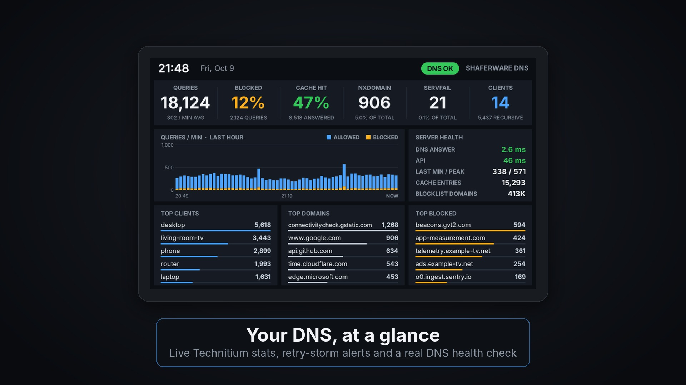
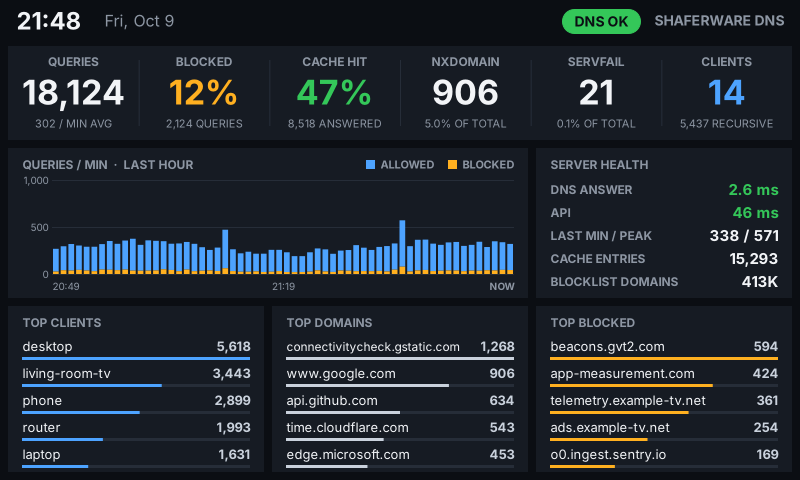
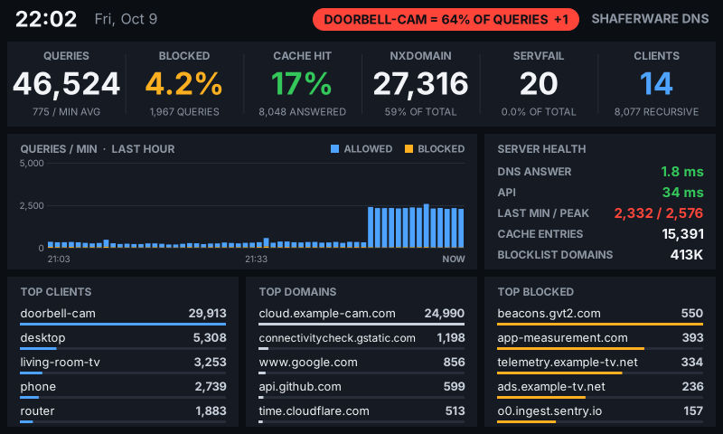
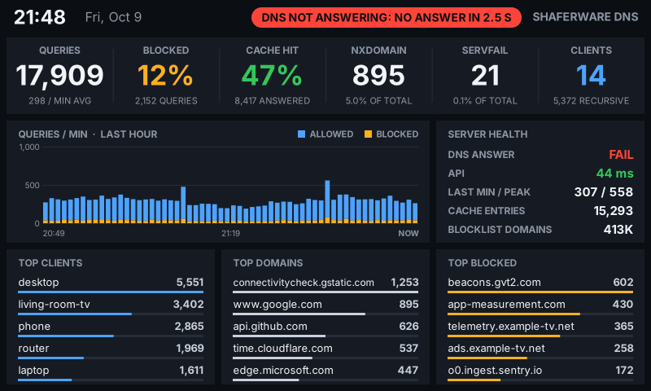
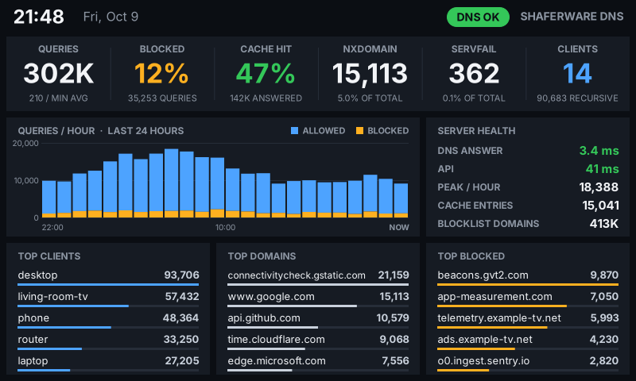

<p align="center">
  
</p>

<h1 align="center">ShaferWare DNS Monitor</h1>

<p align="center"><strong>Your DNS, at a glance.</strong><br>
Live Technitium DNS stats on a VoCore screen, with retry-storm alerts and a real DNS health check. No browser tab. No subscription.</p>

<p align="center">
  <a href="../../releases/latest"><strong>⬇ Download the latest version (Windows)</strong></a>
  &nbsp;·&nbsp;
  <a href="https://shaferware.com/dns-monitor">shaferware.com/dns-monitor</a>
</p>



DNS Monitor is freeware. This repository holds the downloads, documentation and issue tracker; the source code is not published.

## Features

- **Live stats**: Queries, blocked %, cache hit %, NXDOMAIN, SERVFAIL and client count from your Technitium server, refreshed every 10 seconds.
- **Query chart**: Queries per minute for the last hour, with blocked queries in amber. Switch to per hour for the last 24 hours in `settings.ini`.
- **Top lists**: Your top clients, top domains and top blocked domains, each with a bar so the busiest stand out.
- **Retry-storm alerts**: When one device makes most of your DNS traffic, like a camera stuck in a loop, the status pill turns amber, then red, and names it.
- **Health check**: Sends a real DNS query every 30 seconds and times the answer, and times the API too. If DNS stops answering, you see it right away.
- **Friendly names**: Shows names from your PTR records, or your own labels from `settings.ini`, instead of bare IP addresses.

| All good | Retry storm | DNS not answering | Last 24 hours |
|---|---|---|---|
|  |  |  |  |

## Security

- **Read-only token**: Uses a Technitium user that can only view the dashboard. It can't change any settings.
- **Encrypted at rest**: The API token is encrypted with Windows DPAPI the first time the app starts, so only your Windows account can read it.
- **No admin rights**: Runs as a normal user from the system tray.
- **Talks only to your server**: DNS Monitor connects to your Technitium server and nothing else. It sends no telemetry.

## Download

Get the zip from the [latest release](../../releases/latest). Each release lists the file's SHA-256 so you can check your download:

```powershell
Get-FileHash .\ShaferWare-DNS-Monitor-0.1.zip
```

## Requirements

- Windows 10 or 11, 64-bit (.NET Framework 4.7.2, which is built into Windows)
- VoCore USB screen, 800x480 (tested on the 5" V7B panel)
- The VoCore USB driver (WinUSB/libusb). If SimHub or SysDash has already driven your screen, the driver is installed.
- Technitium DNS Server with its web console reachable from this PC (tested with v15)
- Close ShaferWare SysDash and SimHub before starting DNS Monitor, because only one program can drive the screen at a time.

## Quick start

1. In Technitium, add a read-only `vocore` user and create an API token for it (see [Technitium setup](#technitium-setup) below).
2. Unzip DNS Monitor, open `settings.ini`, and enter your server address and the token.
3. Run `ShaferWareDnsMonitor.exe`. Your dashboard appears on the VoCore screen within a few seconds.
4. Optional: run `install.bat` to start DNS Monitor with Windows.

## Technitium setup

### Create the read-only user

1. Log in to the Technitium web console as an administrator.
2. Go to **Administration > Users** and click **Add User**.
3. Username: `vocore`. Use a long, random password; you only need it to create the token.
4. Leave **Member Of** empty. Don't add it to Administrators, DNS Administrators or DHCP Administrators. (Member Of only accepts group names; typing a permission like "View" there gives "No such group exists".)
5. Save.

### Give it dashboard access only

6. Go to **Administration > Permissions**, find the **Dashboard** row and click edit.
7. Under **User Permissions**, add `vocore` and tick **View** only. Leave Modify and Delete unticked. Save.

### Create the API token

8. Log out, then log in as `vocore`.
9. Click **vocore** in the top right and choose **Create API Token**. Name it `VoCore DNS Monitor`.
10. Copy the token right away. It's 64 letters and numbers and is only shown once. Use the API token, not the session code you get from a normal login, which stops working when you log out.

### Check it and add it to DNS Monitor

11. Test it in a browser on the PC that runs DNS Monitor:
    ```
    http://YOUR-SERVER:5380/api/dashboard/stats/get?token=YOUR-TOKEN
    ```
    You should see a page of numbers ending in `"status":"ok"`. `invalid-token` means the token is wrong or was deleted; check **Administration > Sessions** for an API Token row for `vocore`.
12. Paste the token after `api_token =` in `settings.ini` and set `api_url =` to your server. DNS Monitor encrypts the token the first time it starts.

### Tips

- The API token never expires. Changing the `vocore` password later doesn't break it.
- If your network has firewall zones, allow this PC to reach the Technitium web console port (5380, or 53443 for HTTPS).
- For HTTPS, set `api_url = https://YOUR-SERVER:53443` so the token never crosses your network in plain text.

## Alerts

The pill at the top of the screen shows the most serious alert (amber = warning, red = critical). Thresholds are in `settings.ini`.

| Alert | Level |
|---|---|
| API unreachable or token rejected | red |
| DNS not answering the health-check query | red |
| SERVFAIL share of all queries | amber / red |
| One client making a large share of all queries (retry storms) | amber / red |
| Queries in the last full minute | amber / red |
| A client being rate limited | amber |
| Slow DNS answer | amber |

Add friendly names under `[names]` in `settings.ini`, for example `192.168.1.64 = Doorbell Cam`, then use tray icon > **Reload settings**.

## FAQ

**Can it change anything on my DNS server?**
No. It uses a Technitium user that only has Dashboard: View permission, and it only calls the dashboard stats API.

**Can I run it at the same time as SysDash?**
Not on the same screen. Only one program can drive the VoCore at a time, so quit SysDash (and SimHub) first.

**The screen says "API token rejected (invalid-token)".**
Open the test URL from step 11 in a browser. If that works, paste the same token into `settings.ini` again and use tray icon > **Reload settings**. If it doesn't, create a new API token.

**Something isn't working. Where do I look?**
Run `ShaferWareDnsMonitor.exe --test` (or tray icon > **Test connection**). It writes `test.txt` with the result of an API call and a DNS query. Also check `dnsmonitor.log` (tray icon > **Open log**), then [open an issue](../../issues/new/choose).

## Reporting bugs

Use the [bug report form](../../issues/new/choose). Please include your Windows version, Technitium version, VoCore model and the contents of `test.txt` or `dnsmonitor.log`. **Never post your API token**, and replace your server's IP address with something like `SERVER-IP`. See [SECURITY.md](SECURITY.md) for security issues.

## License and credits

- DNS Monitor is freeware: free for personal and commercial use, shared only unmodified and free of charge. See [LICENSE.txt](LICENSE.txt).
- USB: [libusb](https://github.com/libusb/libusb) (LGPL 2.1). Details in [THIRD-PARTY.txt](THIRD-PARTY.txt).
- Technitium, VoCore and SimHub are trademarks of their respective owners. DNS Monitor is not affiliated with any of them.
- Also from ShaferWare: [SysDash](https://shaferware.com/sysdash), live PC stats on the same VoCore screen.

Project page: **https://shaferware.com/dns-monitor**
